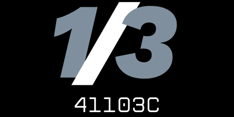
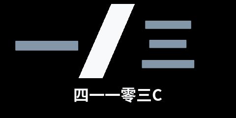

# 41103C 1/3 Code for the Vex V5 2026/2027 Override season

> [!CAUTION]
> **ALL RIGHTS RESERVED - DO NOT COPY OR REUSE**  
> This codebase is publicly viewable for **judging and portfolio review only**. No permission is granted to copy, modify, or use any part of this code on a competition robot. See the [`LICENSE`](./LICENSE) file for full terms.

  
  

[Code Documentation](https://docs.41103c.jenish.tech/)
[Team Website](https://41103c.jenish.tech/)

> [!NOTE]
> This 'states' branch is the new main branch
